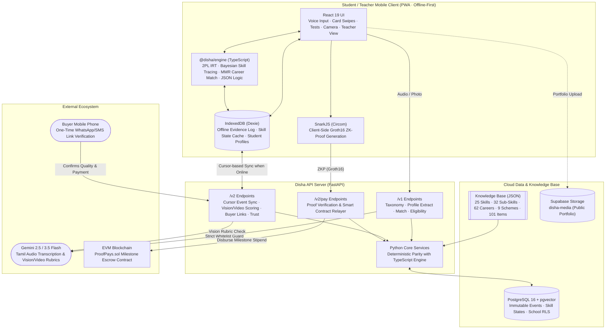

# Disha

**Voice-first, evidence-backed career guidance for rural students.** Disha helps students in Class 9 through graduation discover their hidden vocational and academic skills, objectively measures their true proficiency, and matches them to viable livelihoods, 4-step career pathways, government schemes, and milestone-based micro-incentives. It runs in Tamil and English, on low-cost Android phones, fully offline-first, with dedicated multi-student classroom support for teachers.

Built for the Citi India Hackathon 2026 (Learning-to-Livelihood Track).

---

## The Core Philosophy: "Say it, Prove it, Unlock it"

1. **Say it (Voice & Card Discovery):** The student speaks naturally in Tamil or English about what she makes, repairs, or grows. AI extracts skills only against an approved taxonomy and quotes her exact words.
2. **Prove it (Objective Evidence Gathering):** No self-reported claims are trusted blindly. Skills are validated through Computerized Adaptive Testing (IRT), photo/video work samples scored against rubrics, teacher ratings, and buyer-confirmed paid jobs.
3. **Unlock it (Livelihoods & Proof Pays):** Deterministic rules (JSON Logic) unlock government scholarships (e.g., Pudhumai Penn), NSQF Level 4 RPL certifications, and milestone payouts via zero-knowledge smart contracts (*Proof Pays*).

---

## Key System Numbers & Taxonomy

| Category | Count / Metric | Details |
| --- | --- | --- |
| **Total Skills in Knowledge Base** | **25 Skills** | Full vocational taxonomy across 8 rural & semi-urban sectors (`packages/kb/skills.json`). |
| **Adaptive Tested Skills** | **10 Skills** | Active Computerized Adaptive Testing (IRT) item banks with **32 measurable sub-skills**. |
| **Test Items & Puzzles** | **101 Items** | 42 IRT calibration questions + 59 aptitude puzzles (spatial, mechanical, sequential). |
| **Occupations & Careers** | **62 Careers** | 16 detailed demo pathways with 4-step milestones, local wages, entrance exams, and 5 RPL alignments. |
| **Government Schemes** | **9 Schemes** | Deterministic JSON Logic rules (Pudhumai Penn, Moovalur Ramamirtham, PMKVY RPL, PM Vishwakarma, etc.). |
| **Work-Sample Rubrics** | **2 Rubrics** | Stitched collar/blouse assembly and domestic electrical wiring with safety checklists. |
| **Proficiency Levels** | **4 Levels (NSQF)** | Level 1 (Awareness) → Level 2 (Assisted) → Level 3 (Independent) → Level 4 (Professional / Earning). |

---

## Complete Feature Matrix

### 1. Multi-Student Shared Phone & Offline Architecture
- **Offline-First PWA:** Runs on low-end Android devices in remote rural areas with zero connectivity using IndexedDB (`Dexie.js`).
- **Device Tokens & Class Join Codes:** Schools configure classes with simple join codes (`PSG01`). Devices register securely, and data is partitioned using PostgreSQL Row-Level Security (RLS).
- **Teacher Mode:** A single teacher can manage 30–50 students on a single shared tablet, review pending evidence queues, and endorse student capabilities.

### 2. Bayesian Skill Tracing & Adaptive Testing (IRT)
- **Computerized Adaptive Testing:** Uses 2-Parameter Logistic (2PL) Item Response Theory. Questions dynamically adapt in 3–8 items based on student ability ($\theta$), stopping when standard error drops below 0.4.
- **Continuous Bayesian Updating:** Every piece of evidence (IRT test = 0.7, photo rubric = 0.5, teacher endorsement = 4.0, buyer job = 2.0) updates the probability of skill mastery ($P(L)$) deterministically.

### 3. Rater Trust & Buyer-Confirmed Paid Jobs
- **Buyer SMS Links:** When a student completes an order (e.g., stitching a blouse), a single-use SMS/WhatsApp link (`/v2/confirm/{token}`) allows the customer to verify quality and payment.
- **Rater Reliability (Cohen's Kappa):** The system tracks teacher and reviewer scoring leniency to adjust evidence weight dynamically, preventing inflated scores.

### 4. Proof Pays: Milestone Payouts via Zero-Knowledge Proofs
- **ZK Groth16 Proofs (`ProofPays.sol`):** Philanthropic funders and CSR programs fund milestone escrow contracts (e.g., "Pay ₹2,000 when a girl proves Level 3 Tailoring with 5 buyer-confirmed orders").
- **Privacy-Preserving Verification:** The student’s mobile phone generates a Groth16 ZK proof in ~3 seconds using `snarkjs` and Circom. The smart contract validates eligibility and releases funds directly without exposing the student's name, face, caste, or personal identity.

### 5. 4-Step Career Pathways & Schemes
- **Diverse Career Matching:** Maximal Marginal Relevance (MMR) algorithms recommend occupations across at least 4 distinct sectors to break gender and regional stereotypes.
- **Deterministic Scheme Engine:** Zero AI hallucinations—pure JSON Logic evaluates poverty thresholds, gender, community, and education criteria with 100% mathematical auditability.

---

## Architecture Diagram



---

## Repository Layout

```
apps/
  web/               React 19 + Vite PWA (Student, Teacher, Portfolio, Proof Pays)
    src/screens/     Screens: Voice, Cards, Test, Photo, Video, Jobs, Career, Proof, Teacher
    src/lib/         Dexie DB, Sync, IRT math, Speech, Rater trust, ZK proover, i18n
  api/               FastAPI Server (Python 3.12)
    app/routers/     v1 (KB, Match, Schemes), v2 (Sync, Rubrics, Orders, Trust, Pay, Video)
    app/services/    IRT math, Bayesian tracing, Rater reliability (Cohen's Kappa), Guards
    app/adapters/    Gemini multimodal audio/vision, Keyword fallback matcher
    migrations/      PostgreSQL DDL & RLS policies (0001 to 0007)
    tests/           Pytest test suite (100% passing)
packages/
  engine/            Shared TypeScript engine (runs identical math in browser and Node)
  kb/                Master Knowledge Base: 25 skills, 32 sub-skills, 62 careers, 9 schemes, 101 items
contracts/
  ProofPays.sol      Solidity smart contract for milestone-based zero-knowledge payouts
circuits/
  proof_pays.circom  Circom Zero-Knowledge circuit for anonymous eligibility proofs
scripts/             KB validation, database migrations, golden test generators, simulation
docs/                Architecture specs, benchmarks, and Disha_Project_Guide.md
```

---

## Getting Started

### Prerequisites
- **Node.js**: v22.18+
- **Python**: 3.12+
- **PostgreSQL**: 16+ with `vector` extension (e.g. Supabase or Docker)

### 1. Installation
```bash
npm install
pip install -r apps/api/requirements.txt
cp .env.example .env          # Configure DATABASE_URL, GEMINI_API_KEY, MEDIA_BUCKET
```

### 2. Database Setup & Knowledge Base Load
```bash
python scripts/migrate.py     # Applies schema migrations 0001 through 0007
python scripts/load_kb.py     # Ingests the 25 skills, 62 careers, 9 schemes, and 101 items
```

To create a school and class join code for student registration:
```bash
python scripts/add_join_code.py school sch_psg "PSG Higher Secondary School" Coimbatore
python scripts/add_join_code.py class sch_psg PSG01
```

### 3. Running Locally
```bash
# Terminal 1: Backend API (http://localhost:8000 | Docs: http://localhost:8000/docs)
cd apps/api
python -m uvicorn app.main:app --reload --port 8000

# Terminal 2: Web App (http://localhost:5173)
VITE_API_URL=http://localhost:8000 npm run dev
```

*Note: The web app is fully offline-first; it can be used standalone without the API running.*

---

## API Overview

Interactive Swagger documentation is available at `/docs` when the API server is running:

| Method | Endpoint | Description |
| --- | --- | --- |
| `GET` | `/health` | Healthcheck and active AI/Keyword adapter status. |
| `GET` | `/v1/kb` | Full knowledge base bundle (25 skills, 62 careers, schemes, items). |
| `POST` | `/v1/profile/extract` | Spoken Tamil/English audio or text → extracted skills with student quote evidence. |
| `POST` | `/v1/match` | Ranks career pathways using MMR sector diversity. |
| `POST` | `/v1/eligibility` | Evaluates deterministic JSON Logic rules for government schemes. |
| `POST` | `/v2/sync` | Cursor-based bi-directional event sync between mobile IndexedDB and PostgreSQL. |
| `POST` | `/v2/work-sample/score` | Scores work-sample photo against rubric checklist using Gemini Vision (in-memory). |
| `POST` | `/v2/work-sample/video` | Scores task video step-by-step with timestamps using Gemini Video. |
| `POST` | `/v2/orders/{event_id}/link` | Generates a single-use buyer verification link for a real paid job. |
| `GET/POST`| `/v2/confirm/{token}` | Customer-facing web page to confirm job quality and payment amount. |
| `POST` | `/v2/pay/claim` | Verifies client-side Groth16 ZK proof and triggers milestone payout via smart contract. |

---

## Verification & Testing

```bash
npm test                              # TypeScript engine unit tests + Web typecheck
python scripts/validate_kb.py         # Knowledge base semantic integrity check
python -m pytest apps/api/tests -q    # Full backend API test suite
```

---

## Project Documentation: Which Document to Refer To?


- **Master Reference**: [`Disha_Project_Guide.md`](Disha_Project_Guide.md) is the **master authoritative blueprint** (dated November 2026). It contains the complete end-to-end breakdown, technical deep dives, mathematical proofs, and implementation walkthroughs.
- **Quick Reference**: This `README.md` provides the high-level architecture, quickstart commands, and repository overview.

---

## License
[Apache License 2.0](LICENSE) - Built with pride for rural youth empowerment.
