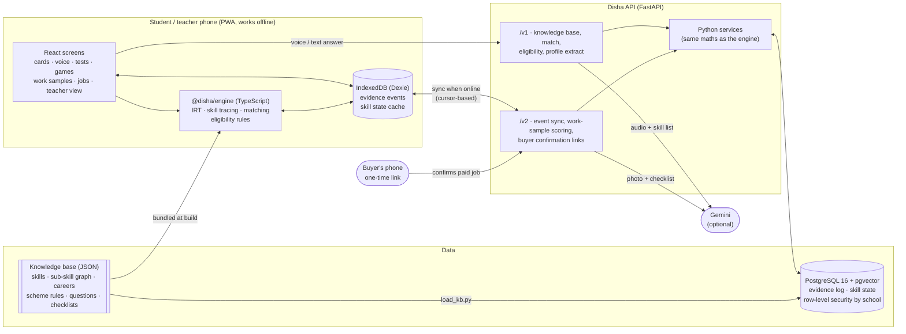

# Disha

**Voice-first career guidance for rural students.** Disha helps a student in Class 9 to graduation find the skills they did not know they had, measures how good they really are, and shows careers, scholarships, schemes and apprenticeships they actually qualify for. It works in Tamil and English, on low-end Android phones, offline, with a teacher who guides a whole class.

Built for the Citi India Hackathon 2026 (learning-to-livelihood track).

---

## The problem

A rural student usually does not know what they are good at, which careers exist beyond doctor, engineer and teacher, or which scholarships and apprenticeships they qualify for. A girl who stitches blouses for neighbours and draws well may still believe she is "not good at anything" because her maths marks are average. Schools, training, mentors and jobs are separate worlds and nobody connects them for her.

## What Disha does

| Part | What the student gets | How |
| --- | --- | --- |
| **Discover** | A strengths card with her own words as proof | Picture cards (RIASEC interests), guided voice questions, AI extraction limited to a fixed skill list |
| **Measure** | A level for each sub-skill, with how sure Disha is | Short adaptive tests (IRT), aptitude games, work-sample photos, teacher ratings, paid jobs confirmed by the buyer |
| **Match** | Careers across at least 4 sectors, each with why it fits and "what if" hints | Fit / Reach / Worth scoring with a variety re-rank |
| **Opportunity** | Schemes she qualifies for now, needs more info for, or will qualify for later | Rule files that decide eligibility (not the AI), run on the phone and the server |
| **Facilitator mode** | One teacher guides 30 to 50 students | Shared-phone profiles, cohort view, confirm work samples, endorse skills |

Skill levels use four plain steps that follow NSQF-style performance criteria:

1. Knows about it
2. Can do it with help
3. Can do it alone
4. Earns from it or teaches it

## Architecture



Key design choices:

- **Offline first.** Everything a student needs (matching, eligibility, skill levels) runs on the phone from the bundled knowledge base. The server is for sync, AI calls and the teacher's cohort view.
- **Evidence is the record.** Every answer, rating, photo score and paid job is an immutable event. Skill levels are always recomputed from events, never edited by hand.
- **One engine, two languages.** The TypeScript engine and the Python services implement the same maths. Golden tests (`packages/engine/test/golden.json`) make sure both give identical results.
- **AI is grounded and replaceable.** Gemini may only pick skill IDs from our list and must quote the student's words; invented IDs are dropped. Without an API key, a keyword matcher takes over and photos wait for the teacher. Rules, not AI, decide eligibility.
- **Privacy by design.** Demo students never leave the phone, photo scoring needs its own consent, photos are scored in memory and never stored on the server, and database rows are isolated by school.

More detail, including the skill-tracing model and the data model, is in [docs/ARCHITECTURE.md](docs/ARCHITECTURE.md).

## Repository layout

```
apps/
  web/               React 19 + Vite PWA (student and teacher app)
    src/screens/     one file per screen
    src/lib/         local database, sync, speech, skill state, i18n (Tamil/English)
  api/               FastAPI server
    app/routers/     v1 (profile, match, eligibility) and v2 (events, work samples, orders)
    app/services/    Python versions of the engine maths
    app/adapters/    Gemini text/audio and vision, keyword fallback
    migrations/      PostgreSQL schema (SQL)
    tests/           pytest suite
packages/
  engine/            shared TypeScript engine, runs in the browser and Node
  kb/                knowledge base: skills, sub-skill graph, careers, schemes, rules, questions
scripts/             knowledge-base checks, loaders, simulation, question generation
docs/                design documents, scope, data plan, progress log, benchmarks
```

## Getting started

### Requirements

- Node.js 22.18 or newer
- Python 3.12
- Docker (for local PostgreSQL), or any PostgreSQL 16 with the `vector` extension

### 1. Install

```bash
npm install
pip install -r apps/api/requirements.txt
cp .env.example .env          # then fill in the values you need
```

### 2. Database

```bash
docker compose up -d          # PostgreSQL 16 + pgvector on port 5432
python scripts/migrate.py     # create the schema
python scripts/load_kb.py     # load the knowledge base
```

### 3. Run

```bash
# API (http://localhost:8000, interactive docs at /docs)
cd apps/api
python -m uvicorn app.main:app --reload --port 8000

# Web app (in another terminal, http://localhost:5173)
VITE_API_URL=http://localhost:8000 npm run dev
```

The student flow also works with no API at all: open the web app alone and it runs fully offline.

To serve everything from one process, run `npm run build`; the API then serves `apps/web/dist` at `/`.

### Environment variables

| Variable | Needed | Purpose |
| --- | --- | --- |
| `DATABASE_URL` | yes (API) | PostgreSQL connection string |
| `GEMINI_API_KEY` | no | Turns on AI skill extraction and photo scoring. Without it, keyword matching and teacher-only scoring are used. Use a paid-tier key for real students. |
| `GEMINI_MODEL` | no | Defaults to `gemini-2.5-flash` |
| `CORS_ORIGINS` | yes (API) | Browser origins allowed to call the API |
| `VITE_API_URL` | no | Where the web app finds the API; empty means same origin |
| `ADMIN_TOKEN` | yes (API) | Protects admin-only endpoints |
| `MEDIA_BUCKET` | no | Storage for portfolio media students chose to share |

## Testing

```bash
npm test                              # engine tests + web type check
python scripts/validate_kb.py         # knowledge-base consistency
python -m pytest apps/api/tests -q    # API tests (needs the database)
```

After changing any engine maths, regenerate the shared golden results and run both suites:

```bash
python scripts/gen_golden.py
```

`scripts/simulate.py` runs the adaptive test against 500 simulated students. Current result (`docs/benchmarks/simulation.json`): 80% of levels estimated exactly, 99.8% within one level, 7.6 questions on average (maximum 8).

CI (`.github/workflows/ci.yml`) runs all of the above on every push and pull request.

## API overview

Full interactive documentation is served at `/docs` when the API is running.

| Method | Path | Purpose |
| --- | --- | --- |
| GET | `/health` | Status, and whether AI or keyword matching is active |
| GET | `/v1/kb` | The whole knowledge base |
| POST | `/v1/profile/extract` | Spoken or typed answer → skills with quoted evidence |
| POST | `/v1/match` | Rank careers for a profile, with "what if" hints |
| POST | `/v1/eligibility` | Check every scheme: eligible now, need more info, or eligible later |
| POST | `/v2/sync` | Send evidence events recorded offline; receive events from other devices |
| POST | `/v2/work-sample/score` | Score a work photo against a checklist (a teacher confirms) |
| POST | `/v2/orders/{event_id}/link` | One-time link for a buyer to confirm a paid job |
| GET/POST | `/v2/confirm/{token}` | The buyer's confirmation page (works once) |

## Knowledge base

All domain data lives in `packages/kb` as JSON, so teachers and NGOs can extend it without touching code. See [packages/kb/README.md](packages/kb/README.md) for formats and rules. Every scheme rule carries its official source link and test fixtures, and `validate_kb.py` rejects unknown skills, sectors or failing rules.

Current demo scope (frozen in [docs/SCOPE.md](docs/SCOPE.md)): 10 skills with 32 measurable sub-skills, 3 aptitude games, 2 work-sample checklists (stitching and basic electrical), 16 careers and 9 schemes and opportunities.

## Status

Built phase by phase; see [docs/PROGRESS.md](docs/PROGRESS.md) for what is done, what is next and open items. Not yet done: privacy hardening (separate consent scopes, full erasure), fairness tests and pilot recalibration, and teacher-reviewed Tamil content. Questions are marked `reviewed: false` until a teacher checks them.

## Documents

- [docs/ARCHITECTURE.md](docs/ARCHITECTURE.md): how the system works
- [docs/SCOPE.md](docs/SCOPE.md): frozen demo scope
- [docs/DATA_PLAN.md](docs/DATA_PLAN.md): knowledge-base data plan and rules
- [docs/PROGRESS.md](docs/PROGRESS.md): build progress
- `docs/Disha_Idea_Note.docx`, `docs/Disha_Implementation_Plan.docx`, `docs/Disha_Skill_Assessment_and_Database.docx`: full design documents

## License

[Apache License 2.0](LICENSE).
