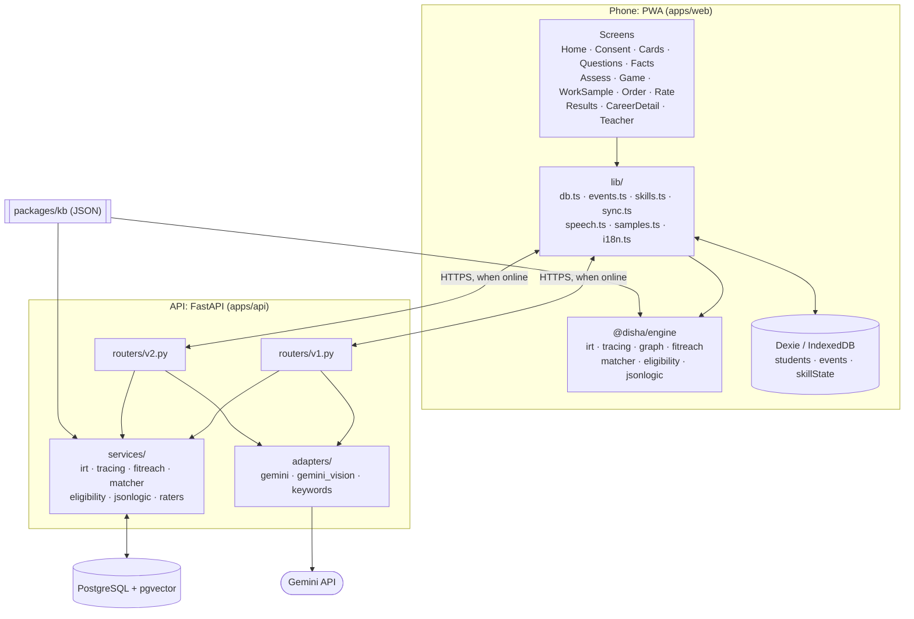
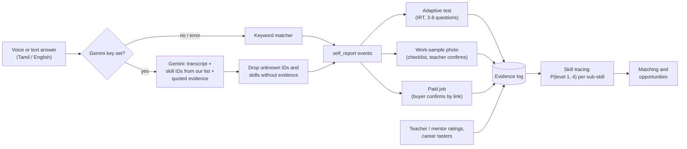
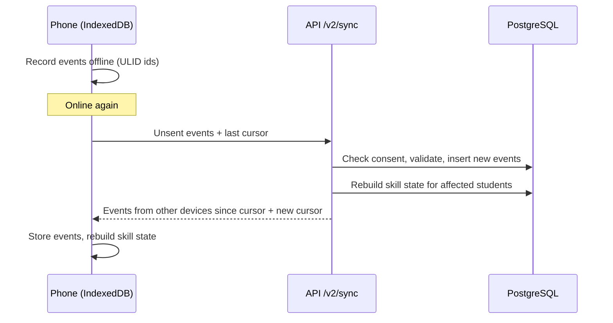
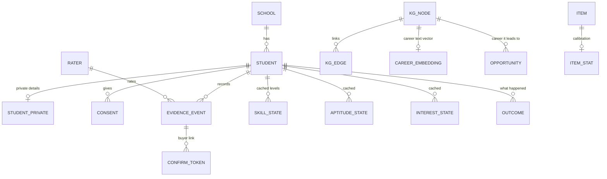

# Disha architecture

This document explains how Disha turns what a student says and does into skill levels, career matches and opportunities. For setup and commands, see the [README](../README.md).

## 1. System overview



| Layer | Technology | Role |
| --- | --- | --- |
| Web app | React 19, Vite, Tailwind, vite-plugin-pwa, Dexie | Installable offline app; voice in and out; shared-phone profiles; teacher mode |
| Engine | TypeScript (no runtime dependencies) | All scoring maths, runs in the browser and in Node tests |
| API | FastAPI, psycopg 3 | Sync, AI calls, buyer confirmation, cohort data |
| Database | PostgreSQL 16, pgvector, row-level security | Evidence log, cached states, knowledge graph, career embeddings |
| Knowledge base | JSON files in `packages/kb` | Skills, sub-skill graph, careers, scheme rules, questions, checklists |
| AI | Gemini (optional) | Speech/text to skills; work-sample photo scoring |

## 2. From a student's answer to a skill level

The pipeline separates **finding** a skill from **measuring** it. What a student says only decides where to look; levels come from evidence.



### 2.1 Evidence events

Everything is recorded as an immutable `EvidenceEvent` (`packages/engine/src/events.ts`, mirrored in `apps/api/app/schemas.py`). IDs are ULIDs, so they sort by time and can be created offline without clashes.

| Kind | Example |
| --- | --- |
| `self_report` | "I stitch blouses for neighbours" |
| `family_report` | A parent says she keeps the shop accounts |
| `item_response` | An answer to a test question |
| `task` | A simulated task or game score |
| `aptitude_response` | An answer in an aptitude game |
| `interest_choice` | A picture-card choice (RIASEC) |
| `work_sample` | A photo of her work scored on a checklist |
| `rating` | A teacher, mentor or buyer rating, or a confirmation of another event (`refers_to`) |
| `order` | A paid job she logged |
| `taster` | A mentor's rating after a career taster |

Skill state on the phone and the server is a cache. It can always be rebuilt from the events.

### 2.2 Adaptive tests (IRT)

`packages/engine/src/irt.ts` / `apps/api/app/services/irt.py`

- Two-parameter IRT: each question has a difficulty and a discrimination.
- Ability is tracked as a posterior over a fixed grid of 41 points from -4 to +4.
- The next question is picked at random among the 3 most informative unseen questions (so friends cannot share answer sequences), with no more than 3 questions of the same format in a row.
- The test stops when the standard error drops below 0.4, or when one level is 85% likely after at least 3 answers, or after 8 questions.
- Each sub-skill has three cut-points that split ability into levels 1 to 4.

On 500 simulated students (`scripts/simulate.py`) this estimates the level exactly 80% of the time and within one level 99.8% of the time, with 7.6 questions on average.

### 2.3 Four-level skill tracing

`packages/engine/src/tracing.ts` / `apps/api/app/services/tracing.py`

Each sub-skill holds four probabilities, one per level:

1. Knows about it
2. Can do it with help
3. Can do it alone
4. Earns from it or teaches it

Starting from a prior of `[0.4, 0.3, 0.2, 0.1]`, each event updates the probabilities with a strength that depends on how trustworthy the evidence is:

| Evidence | Weight |
| --- | --- |
| Self-report | 0.5 |
| Family report | 0.75 |
| Test session | 0.7 |
| Unconfirmed paid job | 1 |
| Teacher endorsement, task | 2 |
| Confirmed paid job | 2 each, up to 5 jobs |
| AI-scored work sample | 3 |
| Teacher level rating | 3 |
| Teacher-confirmed work sample, career taster | 4 |

Other rules:

- **Aging.** Evidence fades with a half-life of one year for things she said and two years for things she showed.
- **Learning drift.** Between sessions, some probability moves up a level (5% per week, at most 20%).
- **Spreading.** Test results spread to related sub-skills in the graph at half strength one step away and quarter strength two steps away. Spread evidence can never make a skill "Strong" on its own.
- **Level 4 needs proof.** Without a confirmed paid job or equivalent, the chance of level 4 is capped at 40%.
- **Strong** means at least 80% confidence in the level, backed by performance evidence (task, work sample, taster, rating or confirmed job).

The weights are starting values. They will be recalibrated with pilot data (Rasch fit and a check for questions that behave differently for girls and boys).

### 2.4 Aptitude

Three short adaptive games (`apt_spatial`, `apt_numeric`, `apt_mechanical`) measure potential separately from current skill. Puzzles are generated as data by `scripts/gen_aptitude.py` and drawn as SVG (`components/Figure.tsx`). High aptitude raises a **could-learn** flag on careers the student cannot do yet.

### 2.5 Work samples

1. The student photographs her work (for example a seam or a switchboard wiring). The phone compresses it.
2. With photo consent, the API scores it against a checklist (`packages/kb/rubrics`) using Gemini vision, item by item rather than one overall grade. The photo is scored in memory and not stored.
3. The score appears in the teacher's queue; the teacher's confirmation upgrades it to the strongest evidence.

Without an AI key, photos go straight to the teacher.

### 2.6 Paid jobs and buyer confirmation

The student logs a paid job. The app asks the API for a one-time link and shares it with the buyer. The buyer sees only the student's first name, answers three questions, and the result is recorded as a rating that `refers_to` the job. Each link works once.

Rater reliability (`services/raters.py`, `scripts/rater_stats.py`) measures each teacher's leniency and agreement (weighted kappa) against neutral evidence.

## 3. Matching careers

`packages/engine/src/fitreach.ts` / `apps/api/app/services/fitreach.py`

```
score = 0.40 Fit + 0.35 Reach + 0.25 Worth
```

| Part | Question | Made of |
| --- | --- | --- |
| **Fit** | Can she do the career's sub-skills now? | Chance she is at or above each needed level, weighted by importance |
| **Reach** | Could she get there? | Aptitude (40%), closeness to needed levels (30%), education gap (30%) |
| **Worth** | Would she want it? | Interest match (60%), local demand in Tamil Nadu (40%) |

After scoring, an MMR re-rank with a sector rule makes the top list cover at least 4 sectors, so options widen instead of repeating the popular few. "What if" hints re-run the score with one sub-skill raised to level 3 or one more level of education, and show which careers open up. A best-next-test picker suggests the test that would change the result most.

## 4. Opportunities and eligibility

Each scheme or opportunity is a JSON Logic rule in `packages/kb/rules/` with its official source link and test fixtures. The same rule runs on the phone (`engine/src/eligibility.ts`) and the server (`services/eligibility.py`), so eligibility works in airplane mode. The rule engine understands missing data and returns one of:

- **Eligible now**
- **Need more info** (with the exact missing detail)
- **Eligible later** (for example after joining a diploma)

The AI never decides eligibility.

## 5. Offline sync



- Events are append-only and have stable IDs, so a retry does not create duplicates.
- Events for students without consent are rejected, with the reason sent back.
- The server returns events in pages, so a phone that was offline for a long time catches up in steps.
- Demo students (made-up profiles) never leave the phone.
- Phone and server rebuild skill state with the same maths, so they agree.

## 6. Data model

Defined in `apps/api/migrations/` (SQL, applied by `scripts/migrate.py`).



- `evidence_event` is the source of truth; `*_state` tables are caches.
- Names and phone numbers stay in `student_private`, apart from the analytic tables.
- Row-level security limits each school to its own students (`0003_security.sql`).
- `item` (test questions) and `rubric` (work-sample checklists) are loaded from the knowledge base.
- `kg_node` / `kg_edge` hold the skill graph: 25 skills, 32 sub-skills, 3 aptitudes and their links to careers.

## 7. Keeping two implementations in step

The engine exists in TypeScript (phone) and Python (server). To keep them identical:

1. `scripts/gen_golden.py` runs the Python code on fixed cases and writes `packages/engine/test/golden.json`.
2. `packages/engine/test/parity.test.ts` checks the TypeScript results match.
3. `packages/engine/src/pymath.ts` copies Python's rounding and float behaviour where it matters.

Any change to the maths needs both files updated, the golden file regenerated, and both test suites passing.

## 8. AI safety and grounding

- Gemini only chooses from our skill IDs and must quote the student's words. Anything else is dropped.
- Temperature is low (0.1) and output is forced to a JSON schema.
- Every AI step has a non-AI fallback, so the app never breaks.
- AI scores are suggestions; a teacher confirms work samples before they count fully.
- Careers, pathways and scheme rules come from the knowledge base with source links, not from the AI.
- Use a paid-tier Gemini key for real students: free-tier inputs may be used to improve Google products.
