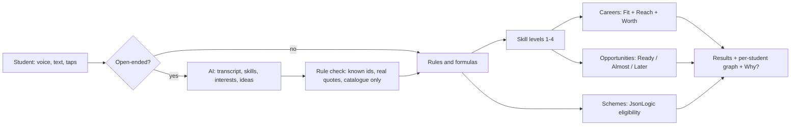

# How Disha decides

_Generated from `packages/engine/src/registry.ts` by `node scripts/gen_decisions_doc.ts`. Do not edit by hand._

**Rules decide, AI listens.** Every decision about a student is made by a fixed rule or formula: the same input always
gives the same answer, and each one has tests. AI is used only where rules cannot work: understanding free speech and
text in her language, scoring a photo or video as one rater among several, and suggesting wider career ideas from our
catalogue. Every AI output passes a rule check before it is used, and the app's **decision X-ray** (`?xray=1`) shows
each decision live, tagged RULE, AI, or AI → RULE-CHECKED.

| Kind | Count |
|---|---|
| Rules | 24 |
| Formulas | 5 |
| Guardrails | 14 |
| AI tasks (each checked by a rule) | 8 |

## End to end



1. **onboarding**: Who is she? Age, situation, reading comfort → which screens she gets
2. **interests**: What does she like? Picture cards, or her own words by voice or typing
3. **skills**: What can she do? Answers, tests, work samples, teacher ratings, paid jobs → level 1-4 per skill
4. **careers**: Which careers fit? Fit + Reach + Worth, spread across sectors
5. **schemes**: Which scholarships and schemes? JsonLogic rule per scheme
6. **opportunities**: Which internships, apprenticeships, jobs, mentors? Hard checks + skill share
7. **aim_high**: Which higher-study route and exam? Route graph + readiness + study plan
8. **safety**: Child safety, consent and privacy guardrails around everything
9. **payouts**: Who confirms a skill, and when a donor's money may go to her
10. **access**: Who may sign in and what each role may see

## Rules versus AI at a glance

| Decision | Made by | Registry id |
|---|---|---|
| Which screens she gets | RULE | `rule.uimode` |
| Who may give consent | GUARDRAIL | `rule.consent_age` |
| Interests from picture cards | FORMULA | `formula.riasec_cards` |
| AI: interests from her own words | AI → checked by `guard.interest_quote` | `ai.interests` |
| Interest check | GUARDRAIL | `guard.interest_quote` |
| Interests offline | RULE | `rule.interest_keywords` |
| When to ask a follow-up | RULE | `rule.followup_when` |
| AI: follow-up question | AI → checked by `guard.followup` | `ai.talk_followup` |
| Follow-up check | GUARDRAIL | `guard.followup` |
| No interests given | RULE | `rule.interest_unknown` |
| AI: skills from an answer | AI → checked by `guard.skill_ids` | `ai.extract_skills` |
| Skill check | GUARDRAIL | `guard.skill_ids` |
| Skill level 1-4 (Bayesian tracing) | FORMULA | `formula.tracing` |
| Adaptive test (IRT) | FORMULA | `formula.irt` |
| AI: scoring a work photo or video | AI → checked by `formula.rater_kappa` | `ai.vision_score` |
| How much the AI rater counts | GUARDRAIL | `formula.rater_kappa` |
| Career score (Fit + Reach + Worth) | FORMULA | `formula.fitreach` |
| Spread across sectors | RULE | `rule.mmr` |
| AI: wider career ideas | AI → checked by `guard.career_catalogue` | `ai.suggest_careers` |
| Career catalogue check | GUARDRAIL | `guard.career_catalogue` |
| AI: her order and her reasons | AI → checked by `guard.personal_order` | `ai.personalise_careers` |
| Shortlist and quote check | GUARDRAIL | `guard.personal_order` |
| Ready / Almost / Later | RULE | `rule.readiness` |
| RPL certification | RULE | `rule.rpl` |
| Higher-study route and readiness | FORMULA | `formula.pathways` |
| No hazardous tasks under 18 | GUARDRAIL | `guard.hazard_minor` |
| Consent scopes | GUARDRAIL | `guard.consent_scope` |
| Face blur on the phone | GUARDRAIL | `guard.face_blur` |
| Teacher override of a skill level | RULE | `rule.override` |
| Is it really her in the video? | RULE | `rule.identity` |
| System confirms, or the teacher looks | RULE | `rule.autoconfirm` |
| May a donor pay her? | RULE | `rule.paycheck` |
| May she send the application? | RULE | `rule.apply_docs` |
| AI: reading an uploaded resume | AI → checked by `guard.skill_ids` | `ai.resume_read` |
| AI: first look at a document | AI → checked by `rule.apply_docs` | `ai.doc_check` |
| Sign-in with a one-time code | GUARDRAIL | `rule.otp` |
| What each role sees | GUARDRAIL | `guard.role_scope` |
| Customer privacy | GUARDRAIL | `guard.buyer_privacy` |
| Which course lessons are open | RULE | `rule.course_access` |
| Which teacher courses to suggest | RULE | `rule.course_recommend` |
| Course payments | GUARDRAIL | `guard.payment_signature` |
| Proof Pays | RULE | `rule.proof_pays` |

## Onboarding

### Which screens she gets · `RULE`

- **Id:** `rule.uimode`
- **Decides:** Picture mode, mixed mode or voice/text mode, from age and reading comfort. She can always switch.
- **Rule / formula:** `reads 'someone helps' or age < 14 → picture; reads 'a little' or age < 17 → mixed; else (reads easily) → voice/text`
- **Code:** `packages/engine/src/uimode.ts`

```json
{
 "pictureBelowAge": 14,
 "voiceTextFromAge": 17
}
```

## Interests

### Interests from picture cards · `FORMULA`

- **Id:** `formula.riasec_cards`
- **Decides:** Interest score per RIASEC letter from the 18 like/dislike cards.
- **Rule / formula:** `score(letter) = liked cards of that letter ÷ 3`
- **Code:** `apps/web/src/data/cards.ts`

### AI: interests from her own words · `AI`

- **Id:** `ai.interests`
- **Decides:** Reads free speech or text (Tamil, Hindi, English) and proposes RIASEC letters with quotes.
- **Checked by:** `guard.interest_quote`
- **Code:** `apps/api/app/adapters/gemini.py (interests)`

### Interest check · `GUARDRAIL`

- **Id:** `guard.interest_quote`
- **Decides:** Keeps an AI interest only if the letter is one of R I A S E C and its quote is really in what she said.
- **Code:** `packages/engine/src/interests.ts (checkInterests)`

### Interests offline · `RULE`

- **Id:** `rule.interest_keywords`
- **Decides:** With no internet, finds RIASEC letters from a word list in Tamil, Hindi and English.
- **Code:** `packages/engine/src/interests.ts (interestsFromKeywords)`

### When to ask a follow-up · `RULE`

- **Id:** `rule.followup_when`
- **Decides:** Asks one more question when her answer was vague, so the conversation follows what she said.
- **Rule / formula:** `vague = fewer than 2 interest areas found OR fewer than 6 words; at most 2 follow-ups`
- **Code:** `packages/engine/src/aichecks.ts (isVague)`

### AI: follow-up question · `AI`

- **Id:** `ai.talk_followup`
- **Decides:** Writes one short follow-up question in her language that builds on what she just said.
- **Checked by:** `guard.followup`
- **Code:** `apps/api/app/adapters/gemini_tasks.py (followup)`

### Follow-up check · `GUARDRAIL`

- **Id:** `guard.followup`
- **Decides:** Keeps the AI question only if it is one short question that does not ask about caste, religion, money, phone number, address or Aadhaar. Otherwise a fixed question is asked.
- **Code:** `packages/engine/src/aichecks.ts (checkFollowup)`

### No interests given · `RULE`

- **Id:** `rule.interest_unknown`
- **Decides:** If she skips interests ('don't know yet'), no interest is guessed: the interest part is 0 for every career, so it favours none and careers are ranked on skills, reach and local demand.
- **Rule / formula:** `interest = cosine(empty vector, career) = 0 for every career`
- **Code:** `packages/engine/src/matcher.ts (studentRiasecVec)`

## Skills

### AI: skills from an answer · `AI`

- **Id:** `ai.extract_skills`
- **Decides:** Turns a spoken or typed answer into a transcript, skills and experiences, each with her own words as evidence.
- **Checked by:** `guard.skill_ids`
- **Code:** `apps/api/app/adapters/gemini.py (extract)`

### Skill check · `GUARDRAIL`

- **Id:** `guard.skill_ids`
- **Decides:** Drops any skill id not in the skill list, or without a quote. Offline, a keyword match is used instead.
- **Code:** `apps/api/app/adapters/gemini.py, apps/web/src/lib/keywords.ts`

### Skill level 1-4 (Bayesian tracing) · `FORMULA`

- **Id:** `formula.tracing`
- **Decides:** Her level and confidence in every sub-skill, from all evidence.
- **Rule / formula:** `posterior ∝ prior × Π likelihood(evidence | level)^(weight × age factor × rater reliability); learning drift +0.05/week (max 0.2); spreads 0.5 / 0.25 to related sub-skills`
- **Code:** `packages/engine/src/tracing.ts (foldEvents)`

```json
{
 "prior": [
  0.4,
  0.3,
  0.2,
  0.1
 ],
 "evidence_weights": {
  "self_report": 0.5,
  "family_report": 0.75,
  "endorse": 2,
  "item_group": 0.7,
  "task": 2,
  "work_sample_ai": 3,
  "work_sample_teacher": 4,
  "rating_level": 3,
  "taster": 4,
  "order_unconfirmed": 1,
  "order_confirmed": 2
 },
 "half_life_days": {
  "said": 365,
  "shown": 730
 },
 "strong": "level ≥ 3 and confidence ≥ 0.8",
 "max_confirmed_orders": 5
}
```

### Adaptive test (IRT) · `FORMULA`

- **Id:** `formula.irt`
- **Decides:** Which question comes next, and when the test stops.
- **Rule / formula:** `2PL model P(correct) = 1/(1+e^(−a(θ−b))); next = most informative of top 3; stop when SE ≤ 0.4, or level confidence ≥ 0.85 after 3 questions, or after 8`
- **Code:** `packages/engine/src/irt.ts`

```json
{
 "STOP_SE": 0.4,
 "STOP_LEVEL_CONFIDENCE": 0.85,
 "MIN_ITEMS": 3,
 "MAX_ITEMS": 8
}
```

### AI: scoring a work photo or video · `AI`

- **Id:** `ai.vision_score`
- **Decides:** Scores each checklist step 0/1/2 with a reason (and a time stamp for video). Counts as one rater, never the final word.
- **Checked by:** `formula.rater_kappa`
- **Code:** `apps/api/app/adapters/gemini_vision.py, gemini_video.py`

### How much the AI rater counts · `GUARDRAIL`

- **Id:** `formula.rater_kappa`
- **Decides:** The AI's scores are weighted by how well it agrees with teachers; a teacher's score replaces the AI's for the same work.
- **Rule / formula:** `AI weight = max(0.3, quadratic weighted kappa vs teachers)`
- **Code:** `apps/api/app/services/raters.py`

### Teacher override of a skill level · `RULE`

- **Id:** `rule.override`
- **Decides:** A teacher may set a different level with a written reason. Lowering always applies. Raising is shown to her but never counts as proof for payouts, and 'Strong' still needs her own work.
- **Rule / formula:** `latest override per sub-skill wins; reason ≥ 8 characters; computed level kept beside it`
- **Code:** `packages/engine/src/trust.ts (applyOverrides)`

```json
{
 "minReasonChars": 8
}
```

### Is it really her in the video? · `RULE`

- **Id:** `rule.identity`
- **Decides:** A liveness challenge (show N fingers, checked by hand tracking) and a face match against the face she enrolled, computed on the phone. Only the numbers leave the phone.
- **Rule / formula:** `verified = liveness passed AND share of frames with face distance ≤ 0.5 ≥ 0.6`
- **Code:** `packages/engine/src/trust.ts (identityCheck), apps/web/src/lib/identity.ts`

```json
{
 "maxFaceDistance": 0.5,
 "minMatchedShare": 0.6,
 "livenessRequired": true
}
```

### System confirms, or the teacher looks · `RULE`

- **Id:** `rule.autoconfirm`
- **Decides:** An AI-scored task video is confirmed by the system only when every check passes; otherwise, and for a random spot-check share, it goes to the teacher.
- **Rule / formula:** `identity verified ∧ no integrity flags ∧ no safety notes ∧ cannot-see ≤ 20% ∧ AI κ ≥ 0.6 ∧ not hazardous for a minor; then 10% still go to a teacher`
- **Code:** `packages/engine/src/trust.ts (autoConfirm)`

```json
{
 "minKappa": 0.6,
 "maxCannotSee": 0.2,
 "auditShare": 0.1
}
```

### Which course lessons are open · `RULE`

- **Id:** `rule.course_access`
- **Decides:** Free course: all lessons. Any course: the first lesson is a free preview. Pay per lesson: a lesson opens after its payment. Subscription: all lessons while it is valid. Locked lessons send only their title; quiz answers never leave the server.
- **Rule / formula:** `open = own course ∨ plan = free ∨ position < 1 ∨ paid(lesson) ∨ paid subscription with valid_until > now; quiz pass ≥ 70% → a "task" evidence event`
- **Code:** `apps/api/app/routers/courses.py (module_open)`

```json
{
 "platformFee": 0.1,
 "quizPass": 0.7,
 "previewLessons": 1,
 "topCareers": 3
}
```

### Which teacher courses to suggest · `RULE`

- **Id:** `rule.course_recommend`
- **Decides:** A course is suggested when the skill it trains is below what one of her top careers needs, or is a gap for an internship/job she is 'Almost' ready for.
- **Rule / formula:** `skill level < level needed by one of her top 3 careers ∨ skill ∈ gaps of an 'Almost' opportunity`
- **Code:** `packages/engine/src/courses.ts (recommendCourses)`

## Careers

### Career score (Fit + Reach + Worth) · `FORMULA`

- **Id:** `formula.fitreach`
- **Decides:** How well each career fits her now and could fit her later.
- **Rule / formula:** `score = 0.4·Fit + 0.35·Reach + 0.25·Worth; Reach = 0.4·aptitude + 0.3·closeness + 0.3·education; Worth = 0.6·interest + 0.4·local demand`
- **Code:** `packages/engine/src/fitreach.ts`

```json
{
 "FRW_WEIGHTS": {
  "fit": 0.4,
  "reach": 0.35,
  "worth": 0.25
 },
 "REACH_PARTS": {
  "aptitude": 0.4,
  "closeness": 0.3,
  "education": 0.3
 },
 "WORTH_PARTS": {
  "interest": 0.6,
  "demand": 0.4
 },
 "DEMAND": {
  "high": 1,
  "medium": 0.7,
  "low": 0.4
 },
 "need_met_at": 0.6,
 "no_evidence_levels": [
  0.5,
  0.3,
  0.15,
  0.05
 ],
 "no_evidence_credit": 0.5
}
```

### Spread across sectors · `RULE`

- **Id:** `rule.mmr`
- **Decides:** Re-ranks careers so the list is not all one kind of work.
- **Rule / formula:** `MMR re-rank, λ = 0.7, at least 4 sectors in the top list`
- **Code:** `packages/engine/src/matcher.ts (mmrRerank)`

### AI: wider career ideas · `AI`

- **Id:** `ai.suggest_careers`
- **Decides:** Proposes careers she may not have thought of, chosen only from our career catalogue, with a reason each.
- **Checked by:** `guard.career_catalogue`
- **Code:** `apps/api/app/adapters/gemini.py (suggest_careers)`

### Career catalogue check · `GUARDRAIL`

- **Id:** `guard.career_catalogue`
- **Decides:** Drops any AI career that is not in the catalogue; the rest are scored by the same Fit + Reach + Worth formula. The AI never ranks.
- **Code:** `apps/api/app/routers/v1.py (careers/suggest), packages/engine/src/fitreach.ts`

### AI: her order and her reasons · `AI`

- **Id:** `ai.personalise_careers`
- **Decides:** Re-orders the formula's top 5 careers for her and writes 'why this fits you' for each, quoting her own words.
- **Checked by:** `guard.personal_order`
- **Code:** `apps/api/app/adapters/gemini_tasks.py (personalise_careers)`

### Shortlist and quote check · `GUARDRAIL`

- **Id:** `guard.personal_order`
- **Decides:** The rules decide which careers are allowed; the AI may only change their order. Careers outside the shortlist are dropped, careers it left out keep formula order, and a reason is kept only if its quote is really in what she said.
- **Code:** `packages/engine/src/aichecks.ts (checkPersonalised)`

## Schemes

### National Means-cum-Merit Scholarship (NMMS) · `RULE`

- **Id:** `rule.sch_nmms`
- **Decides:** Scheme eligibility: eligible, need more information, or eligible later (JsonLogic). The AI never decides eligibility.
- **Rule / formula:** `NMMS: apply in Class 8 at a government or aided school (Kendriya Vidyalaya, Navodaya, Sainik and residential schools excluded); family income up to Rs 3.5 lakh; at least 55% in Class 7 (50% for SC/ST). Mostly useful for younger siblings, since Disha users are Class 9 and above.`
- **Code:** `packages/kb/rules/sch_nmms.json`

```json
{
 "updated": "2026-11-11"
}
```

### Post-Matric Scholarship for SC Students · `RULE`

- **Id:** `rule.sch_post_matric_sc`
- **Decides:** Scheme eligibility: eligible, need more information, or eligible later (JsonLogic). The AI never decides eligibility.
- **Rule / formula:** `Post-Matric Scholarship for SC students after Class 10 (Class 11 onwards, ITI, diploma, degree); family income up to Rs 2.5 lakh.`
- **Code:** `packages/kb/rules/sch_post_matric_sc.json`

```json
{
 "updated": "2026-11-11"
}
```

### AICTE Pragati Scholarship for Girls · `RULE`

- **Id:** `rule.sch_pragati`
- **Decides:** Scheme eligibility: eligible, need more information, or eligible later (JsonLogic). The AI never decides eligibility.
- **Rule / formula:** `AICTE Pragati: girls admitted to first year (or second year by lateral entry) of an AICTE-approved diploma or degree; family income up to Rs 8 lakh; at most 2 girls per family. Renewals continue in later years (renewal not modelled).`
- **Code:** `packages/kb/rules/sch_pragati.json`

```json
{
 "updated": "2026-11-11"
}
```

### Pre-Matric Scholarship for SC Students (Class 9–10) · `RULE`

- **Id:** `rule.sch_pre_matric_sc`
- **Decides:** Scheme eligibility: eligible, need more information, or eligible later (JsonLogic). The AI never decides eligibility.
- **Rule / formula:** `Pre-Matric Scholarship for SC students in Classes 9-10; family income up to Rs 2.5 lakh.`
- **Code:** `packages/kb/rules/sch_pre_matric_sc.json`

```json
{
 "updated": "2026-11-11"
}
```

### Pudhumai Penn Scheme · `RULE`

- **Id:** `rule.sch_pudhumai_penn`
- **Decides:** Scheme eligibility: eligible, need more information, or eligible later (JsonLogic). The AI never decides eligibility.
- **Rule / formula:** `Girls who studied Classes 6-12 in a TN government school; extended 30 Dec 2024 to Tamil-medium students of government-aided schools. Paid while in higher education (ITI, diploma, degree).`
- **Code:** `packages/kb/rules/sch_pudhumai_penn.json`

```json
{
 "updated": "2026-11-11"
}
```

### AICTE Saksham Scholarship (Specially-abled) · `RULE`

- **Id:** `rule.sch_saksham`
- **Decides:** Scheme eligibility: eligible, need more information, or eligible later (JsonLogic). The AI never decides eligibility.
- **Rule / formula:** `AICTE Saksham: students with 40% or more disability admitted to first year (or second year by lateral entry) of an AICTE-approved diploma or degree; family income up to Rs 8 lakh. Same structure as Pragati; confirm in the AICTE guidelines.`
- **Code:** `packages/kb/rules/sch_saksham.json`

```json
{
 "updated": "2026-11-11"
}
```

### Tamil Pudhalvan Scheme · `RULE`

- **Id:** `rule.sch_tamil_pudhalvan`
- **Decides:** Scheme eligibility: eligible, need more information, or eligible later (JsonLogic). The AI never decides eligibility.
- **Rule / formula:** `Boys who studied Classes 6-12 in a TN government school, paid while in higher education. Check whether the Dec 2024 aided-school extension and the third-gender inclusion also apply here.`
- **Code:** `packages/kb/rules/sch_tamil_pudhalvan.json`

```json
{
 "updated": "2026-11-11"
}
```

## Opportunities

### Ready / Almost / Later · `RULE`

- **Id:** `rule.readiness`
- **Decides:** Whether she is ready to apply for an internship, apprenticeship, job, mentorship or training.
- **Rule / formula:** `hard checks (age, education, programme rule) must not fail; skill share = needs met ÷ needs; ≥ 80% Ready, ≥ 50% Almost, else Later`
- **Code:** `packages/engine/src/readiness.ts`

```json
{
 "READY_SHARE": 0.8,
 "ALMOST_SHARE": 0.5,
 "need_met_at": 0.6
}
```

### RPL certification · `RULE`

- **Id:** `rule.rpl`
- **Decides:** She can apply for a government certificate (PMKVY RPL) for a skill she already has.
- **Rule / formula:** `level ≥ 4 in a sub-skill the qualification covers, and age ≥ 18`
- **Code:** `packages/engine/src/rpl.ts`

### May she send the application? · `RULE`

- **Id:** `rule.apply_docs`
- **Decides:** Every document the listing needs is verified (by a teacher, or a Disha-made resume from her verified record) and she is not 'Later' on readiness.
- **Rule / formula:** `internship: resume, id_proof; apprenticeship: resume, id_proof, marksheet, bank_passbook; job: resume, id_proof; mentorship: resume; training: id_proof`
- **Code:** `packages/engine/src/trust.ts (applyCheck)`

```json
{
 "internship": [
  "resume",
  "id_proof"
 ],
 "apprenticeship": [
  "resume",
  "id_proof",
  "marksheet",
  "bank_passbook"
 ],
 "job": [
  "resume",
  "id_proof"
 ],
 "mentorship": [
  "resume"
 ],
 "training": [
  "id_proof"
 ]
}
```

### AI: reading an uploaded resume · `AI`

- **Id:** `ai.resume_read`
- **Decides:** Reads a resume photo or PDF and proposes skills, education and experience with quotes.
- **Checked by:** `guard.skill_ids`
- **Code:** `apps/api/app/routers/trust.py (resume_read)`

### AI: first look at a document · `AI`

- **Id:** `ai.doc_check`
- **Decides:** Says what kind of document a photo shows and whether the name on it matches. It never verifies: a teacher does.
- **Checked by:** `rule.apply_docs`
- **Code:** `apps/api/app/routers/trust.py (doc_check)`

### Paid Apprenticeship (NAPS) · `RULE`

- **Id:** `rule.opp_naps_apprenticeship`
- **Decides:** Programme eligibility (JsonLogic). The AI never decides eligibility.
- **Rule / formula:** `NAPS apprenticeship: minimum age 14, or 18 for hazardous trades; Class 8 passed or more (depends on trade). Eligible means you can register; you still need an employer opening on the portal.`
- **Code:** `packages/kb/rules/opp_naps_apprenticeship.json`

```json
{
 "updated": "2026-11-11"
}
```

### PM Internship Scheme · `RULE`

- **Id:** `rule.opp_pm_internship`
- **Decides:** Programme eligibility (JsonLogic). The AI never decides eligibility.
- **Rule / formula:** `Apr 2026 expansion (reported by BusinessToday, 22 Apr 2026): age 18-25; final-year UG/PG students allowed with institution NOC; family income up to Rs 8 lakh; no family member in a regular government job; not in a full-time job. Confirm against the official MCA notification.`
- **Code:** `packages/kb/rules/opp_pm_internship.json`

```json
{
 "updated": "2026-11-11"
}
```

## Aim high

### Higher-study route and readiness · `FORMULA`

- **Id:** `formula.pathways`
- **Decides:** Shortest route to a goal (doctor, engineer, CA ...), exam readiness, and a weekly study plan.
- **Rule / formula:** `Dijkstra over the route graph with age limits; readiness grows by ability + 0.05/month of study; topics in prerequisite order; spaced practice at 1, 2, 4, 8, 16 days`
- **Code:** `packages/engine/src/pathways.ts`

```json
{
 "GROWTH_PER_MONTH": 0.05,
 "MASTERED": 0.85,
 "LEITNER_DAYS": [
  1,
  2,
  4,
  8,
  16
 ]
}
```

## Safety

### Who may give consent · `GUARDRAIL`

- **Id:** `rule.consent_age`
- **Decides:** A student who is certainly 18 or older may agree herself; anyone else (or unknown age) needs a parent's signed form.
- **Rule / formula:** `currentYear − birthYear ≥ 19 → may self-consent (birth month unknown, so stay on the safe side)`
- **Code:** `packages/engine/src/safety.ts (isMinor)`

### No hazardous tasks under 18 · `GUARDRAIL`

- **Id:** `guard.hazard_minor`
- **Decides:** Removes hazardous checklist steps (e.g. live wiring) for anyone under 18 or of unknown age.
- **Code:** `packages/engine/src/safety.ts`

### Consent scopes · `GUARDRAIL`

- **Id:** `guard.consent_scope`
- **Decides:** Photo/video scoring needs the 'photos' scope; sharing a credential needs 'share_portfolio'. Checked on the server.
- **Code:** `apps/api/app/routers/see.py, proof.py`

### Face blur on the phone · `GUARDRAIL`

- **Id:** `guard.face_blur`
- **Decides:** Faces are pixelated on the phone before any video leaves it; filming is refused if the face model fails.
- **Code:** `apps/web/src/lib/video.ts`

### Customer privacy · `GUARDRAIL`

- **Id:** `guard.buyer_privacy`
- **Decides:** A customer confirming a job is asked first whether Disha may keep their name; without a yes, only the three answers are kept.
- **Code:** `apps/api/app/routers/v2.py (confirm)`

## Payouts

### May a donor pay her? · `RULE`

- **Id:** `rule.paycheck`
- **Decides:** Before money moves: the skill is shown by her own work (not an override), need is verified by a teacher-seen document, her family agreed to share, the video was really her, and she was not paid for it before.
- **Rule / formula:** `skill ∧ need (income ≤ ₹2,50,000 ∧ teacher saw one of income_certificate/ration_card_bpl/scholarship_letter) ∧ consent ∧ identity ∧ once`
- **Code:** `packages/engine/src/trust.ts (payCheck), apps/api/app/routers/trust.py`

```json
{
 "maxIncomeInr": 250000,
 "needDocs": [
  "income_certificate",
  "ration_card_bpl",
  "scholarship_letter"
 ]
}
```

### Course payments · `GUARDRAIL`

- **Id:** `guard.payment_signature`
- **Decides:** The server sets the price and creates the Razorpay order; a lesson unlocks only after the server checks HMAC-SHA256(order_id|payment_id) against Razorpay's signature. No card or UPI data touches Disha. Without keys, a labelled demo payment where no money moves.
- **Rule / formula:** `teacher earns 90%, Disha keeps 10%`
- **Code:** `apps/api/app/adapters/razorpay.py`

### Proof Pays · `RULE`

- **Id:** `rule.proof_pays`
- **Decides:** A funder's money is released only when a zero-knowledge proof shows the skill milestone was met.
- **Code:** `contracts/src/ProofPays.sol, packages/zk`

## Access

### Sign-in with a one-time code · `GUARDRAIL`

- **Id:** `rule.otp`
- **Decides:** Phone or email + a 6-digit code (10 minutes, 5 tries, one use, only its hash stored). The number or email is stored only as an HMAC. Role comes from the school's code, never from the phone.
- **Code:** `apps/api/app/routers/accounts.py`

### What each role sees · `GUARDRAIL`

- **Id:** `guard.role_scope`
- **Decides:** Students and teachers see only their school (row-level security). Donors see anonymous pay checks and payouts only. Employers see applications students chose to send, nothing else.
- **Code:** `apps/api/app/auth.py, migrations/0003_security.sql, 0011_accounts.sql`
