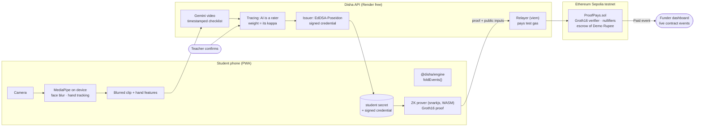

# Innovation plan: Proof Pays

Brainstorm from 19 November 2026. The hackathon judges the technology, uses free resources only, and wants advanced tech that is actually justified. This file records the ideas we considered, the one we chose, and the full technical design.

**One line:** *The phone sees the skill, maths proves it, and money follows.*

---

## Part 1: The ideas we considered

| # | Idea | What it is | Verdict |
| --- | --- | --- | --- |
| 1 | **Proof Pays** | Funders (CSR, Citi Foundation-style programmes, alumni) put money in a pool. A payout is released automatically when Disha's engine proves a student's skill crossed a milestone. Pay for proven progress, not attendance. | **Chosen (core)** |
| 2 | **The phone watches her work** | She films 30 seconds of a task. Each step of the checklist is detected with a time stamp ("0:07 tested the line ✓"). Scores how she works, not only the result. | **Chosen (the live wow moment)** |
| 3 | Career flight simulator | Run a tailoring business for six months in five minutes, with prices from real confirmed orders. Playing it is the test. | Roadmap |
| 4 | Disha phones the parent | A Tamil voice call to a basic phone explaining the proof and the scholarship money. | Roadmap (telephony is not free beyond trial numbers) |
| 5 | Class sync with no internet | Phones sync with each other; one phone carries the class's data to town. | Roadmap (phone-to-phone from a web app is unreliable) |
| 6 | Skill swap with fraud detection | Students trade skills; each trade is evidence; rating rings are detected and down-weighted. | Roadmap |

Earlier idea that is now part of the design: the **skill passport** (a credential that carries its own evidence, and the verifier re-runs the engine to check the level). It becomes the "open proof" mode in Layer 2 below.

---

## Part 2: The technical design

Four layers plus an evaluation layer. Every choice says why something simpler is not enough, because judges punish tech that is only there for show.

### Layer 1. SEE: on-device and cloud video assessment

| Piece | Tech (all free) | Why not something simpler |
| --- | --- | --- |
| Face blur before upload | **MediaPipe Tasks Vision** Face Detector in the browser (`@mediapipe/tasks-vision`, Apache-2.0, WASM + GPU) | Students are minors. Their faces never leave the phone. A server-side blur would mean the raw face was uploaded. |
| Hand tracking | MediaPipe **Hand Landmarker** (21 points per hand) | A photo shows the result only. Hand tracking gives process signals: steadiness, two-hand coordination, time on each step, and whether a hand enters a danger zone. |
| Step detection | **Gemini 3.5 Flash video understanding** (free tier) with a JSON response schema; output limited to the rubric's criterion ids, each with a `MM:SS` time stamp and a short reason | The same grounding rule as voice extraction: ids outside the rubric are dropped. Time stamps let the teacher jump to the moment and check it. |
| Trust in the AI | The AI video scorer is **just another rater** in the Bayesian tracing. Its weight comes from its quadratic weighted kappa against teacher confirmations (`apps/api/app/services/raters.py` already computes this). | The AI never gets more trust than it has earned against teachers, and the number is shown. |

Safety: electrical videos use a **battery-powered switch board only**, never mains. The existing under-18 hazardous-task rule still applies. Videos are scored in memory and never stored, like photos today.

### Layer 2. PROVE: one credential, two ways to show it

The server signs one credential per student. The student chooses how much to show.

**Open proof (full evidence).** For a teacher, an ITI or an employer she trusts. The page shows every piece of evidence and re-runs `foldEvents()` from `@disha/engine` in the verifier's browser, so the level is recomputed, not trusted. The credential must carry the "as of" time, rater weights and the knowledge-base version so the result is reproducible.

**Private proof (zero-knowledge).** For funders and anyone she does not want to show her details to. She proves a statement such as *"machine stitching is at level 3 or above, I have at least 5 buyer-confirmed orders, my family income band is under ₹2.5 lakh, and this credential was signed by Disha and has not expired"*. The verifier learns that the statement is true and nothing else. Caste, exact income, name and the evidence stay on her phone.

| Piece | Tech (all free) | Detail |
| --- | --- | --- |
| Credential | Attributes hashed with **Poseidon**, signed with **EdDSA over BabyJubJub** (`circomlibjs`) | Fields: student secret commitment, 32 sub-skill levels packed 2 bits each, confirmed order count, ₹ earned, income band, gender, district, birth year, issued and expiry dates, cohort. The open proof and the private proof use the same signature. |
| Circuit | **circom 2** with circomlib (`EdDSAPoseidonVerifier`, `Poseidon`, comparators) | Checks: the signature is valid; the chosen sub-skill level is at least the milestone level; orders ≥ k; income band ≤ limit; the credential has not expired; nullifier = Poseidon(student secret, milestone id); the payout address is a public input. Expected size: under about 15,000 constraints (to confirm when built). |
| Proving | **snarkjs Groth16** in the browser (WebAssembly), Hermez powers-of-tau file | The proof is made on her phone, so private data never leaves it. Measure the proving time on a low-end Android phone and put it on the metrics slide. |
| Verifying | snarkjs in the browser (offline, with the bundled key) and the same proof on-chain | Verification takes milliseconds. |

Licence note: snarkjs and circomlib are GPL-3.0. Keep the ZK code in its own package (`packages/zk`) under GPL-3.0; the rest of the repository stays Apache-2.0.

### Layer 3. PAY: proof-gated payouts

| Piece | Tech (all free) | Why |
| --- | --- | --- |
| Escrow contract | **Solidity** `ProofPays.sol` with the Groth16 verifier exported by snarkjs, built and tested with **Foundry** (local **Anvil** chain for development) | Several funders who do not fully trust each other or Disha need one neutral rule. The contract checks the proof itself, so Disha cannot pay favourites or invent students. |
| Network | **Ethereum Sepolia testnet**, test ETH from the free Google Cloud Web3 faucet | Free, public, and every payout has an explorer link judges can open. |
| Money | A demo ERC-20 token, "Demo Rupee" | Clearly not real money. |
| Double-claim and theft protection | A **nullifier** per (student, milestone); the **payout address is a public input** of the proof | The same proof cannot be paid twice, and nobody who intercepts the proof can redirect the money. |
| Gasless for students | **Relayer** in the Disha API using **viem**; it pays the test gas | Students have no crypto wallet. The relayer can submit proofs but cannot forge or redirect them. |
| Funder dashboard | viem `watchContractEvent` on the `Paid` event | Payouts appear live during the demo. |

In production the same proof-gated release would sit on a real Indian payment rail, for example UPI or e-RUPI purpose-bound vouchers, paid to a guardian's or school account for minors. The testnet shows the rule working. Do not claim that Citi will fund or lend.

### Layer 4. PLAN: an agentic counsellor with RAG and MCP

The rule for every AI part: **AI talks, plans and calls tools; the engine and the rules decide.** No AI output ever sets a level, eligibility or a payout.

| Piece | Tech (all free) | Why not something simpler |
| --- | --- | --- |
| Disha tools as an **MCP server** | **FastMCP** (Python) wrapping existing deterministic functions: `get_profile`, `match_careers`, `check_eligibility`, `best_next_evidence`, `milestone_status`, `issue_credential` | One tool layer used by the in-app agent and by any outside assistant an NGO counsellor already uses. The tools are the same code the app runs, so answers match the app exactly. |
| **Agentic counsellor** | **Gemini 3.5 Flash function calling** in a plan, call tools, check, answer loop (max about 5 steps), Tamil and English | A fixed screen cannot answer "I failed maths, can I still become an electrician, and who pays?". The agent chains match, eligibility and the milestone planner to answer, and every number comes from a tool. |
| **Milestone planner** (a tool the agent calls) | Extends the what-if levers and best-next-test picker: value of information over the current skill posterior | Answers "which next piece of evidence most raises the chance of reaching level 3?" with maths, not guesses. |
| **RAG over official scheme documents** | Scheme guidelines and FAQs, chunked, embedded with the **Gemini embedding model** (free tier) into **pgvector** on Supabase (already installed, HNSW index), hybrid search (vector + Postgres full-text) | Students ask questions the rule files do not cover ("can I apply if my father has a bank loan?"). Answers must quote the official text with its link, or say "I don't know, ask your teacher". Rules still decide eligibility; RAG only explains. |
| Guard on the agent | Every answer is checked: numbers must come from a tool result, scheme facts must cite a retrieved chunk, otherwise the answer is replaced by a safe fallback | Stops made-up rupee amounts and dates. |

Evaluation for this layer (add to Layer 5): a set of 30 to 50 student questions with expected tool calls and expected cited passages; report tool-call accuracy, citation correctness and the share of answers that correctly say "I don't know".

### ML already in Disha (say it on the tech slide)

Item response theory with adaptive testing, Bayesian knowledge tracing over a sub-skill graph, Rasch recalibration with misfit and bias (DIF) checks, rater reliability with weighted kappa, MMR re-ranking for career variety, plus the new on-device vision models (MediaPipe) and multimodal Gemini.

### Layer 5. TRUST: evaluations to put on the metrics slide

1. **AI rater agreement:** weighted kappa of the Gemini video scorer against teacher confirmations, and the weight it earns in tracing.
2. **Counterfactual fairness of AI extraction:** pairs of student stories that differ only in gender or caste markers (names, pronouns), generated once with Gemini and saved as fixtures; the extracted skills must match. Runs in CI from the saved fixtures and live nightly within the free quota.
3. **ZK numbers:** constraint count, proving time on a low-end phone, verification time, and on-chain verification gas.
4. **Privacy check:** a test that no face pixels and no private attribute ever leave the phone in a request.

---

## Demo script (about 3 minutes)

1. A team member films 20 seconds of stitching, or of wiring a battery switch board. On screen: the face is blurred live and hand landmarks are drawn over the video.
2. Gemini returns the timestamped checklist. The teacher taps Confirm. Meena's level crosses 3 (the engine recomputes it from events).
3. Meena's phone makes the zero-knowledge proof in a couple of seconds. The screen lists what is proved and what stays hidden.
4. The relayer submits it; the Sepolia contract verifies it and pays Demo Rupees. The funder dashboard updates live, with an explorer link.
5. Attack demo: send the same proof again (rejected: nullifier used); change the payout address (rejected: proof invalid).

## Build order (cut from the bottom if time runs out)

1. **SEE:** video capture with MediaPipe blur and hand overlay, Gemini timestamped checklist, AI as a rater with kappa weight. Uses the existing work-sample and teacher-confirm flow.
2. **PROVE:** credential issuing, the circom circuit, proving and verifying in the browser.
3. **PAY:** contract, Foundry tests, Sepolia deploy, relayer, funder dashboard.
4. **PLAN:** MCP server over the engine tools, the Gemini counsellor agent, RAG over scheme documents.
5. **TRUST:** evaluation numbers for the slide (AI rater kappa, fairness, ZK numbers, agent and RAG accuracy).

## Deliberately left out (so the plan does not contradict itself later)

- On-device Tamil speech recognition: good models are too heavy for low-end phones; keep the current cloud flow.
- Gemini Nano in Chrome: not available on low-end Android phones.
- A zero-knowledge proof that the whole Bayesian engine ran correctly (zkVM): proving is too slow on free hardware. The open proof covers this need by recomputing in the verifier's browser.

## Risks and rules

- **Free Gemini tier:** rate limits, and Google may use free-tier inputs. Use only team-recorded demo videos, never real students' videos, until a paid key is available.
- **Render free plan:** sleeps after idle (about 70 s cold start) and has little memory. Proofs are made on the phone, so the server only relays. Wake the service before the demo.
- **Minors:** payouts go to a guardian's or school account, reward skill gains (never paid work), and video tasks follow the hazardous-task rule.
- **Old phones:** measure proving time early; the circuit is kept small for this reason.
